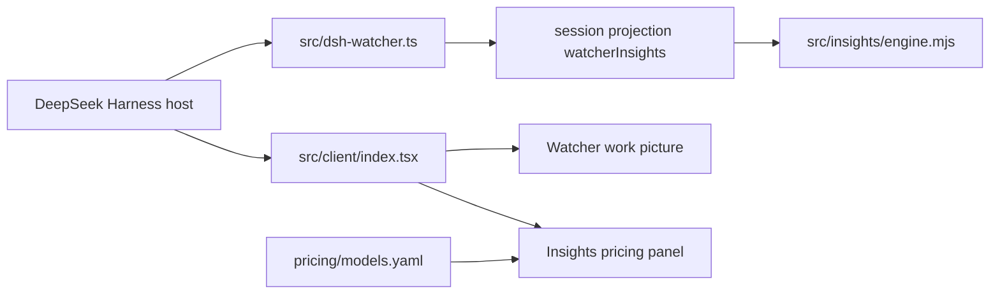

# Watcher architecture

Watcher is one Cordis client plugin. It is not a server, and it does not call an external API.

The host loads `cordis.yml`, which inserts plugin id `dsh-watcher` from `src/dsh-watcher.ts`. `apply` registers session projection `watcherInsights`. The projection stores folded token and timing stats. `src/insights/engine.mjs` is the reducer. Zod in `src/insights/projection.ts` checks the state before it is replayed. The projection does not add a transport and does not write model-facing messages.

The client entry `src/client/index.tsx` injects two host slots:

- `settings.section` renders `InsightsSettings` from `src/client/Insights.tsx`.
- `conversation.session.header.utilities` renders the Watcher button, order 50.

`src/client/Watcher.tsx` reads the host conversation and draws the work picture: turns, steps, parallel tool calls, and the optional model stage. `src/observation/fold.ts` groups those events. A second plugin, dsh-better-sidebar, is optional. `src/client/SidebarTab.tsx` registers a tab only when that service exists. It is not a dependency.

Pricing reads `pricing/models.yaml` and an optional `localStorage` override `dsh-watcher:pricing-override:v1`. Missing prices stay unknown. They are not treated as zero.

`pnpm build` runs `tsc`, then tsdown through the vendored adapter `tools/client-build.js`, and writes `lib/dsh-watcher.js` plus `lib/client.js`. Those two files are what `dsh plugin add` loads. `lib/types/` is only for local tests.
